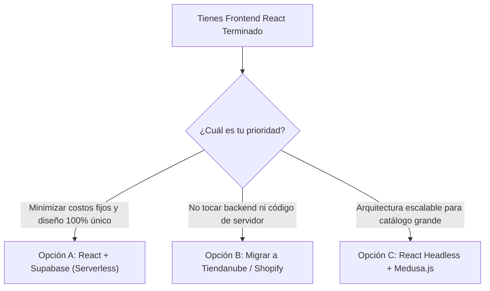
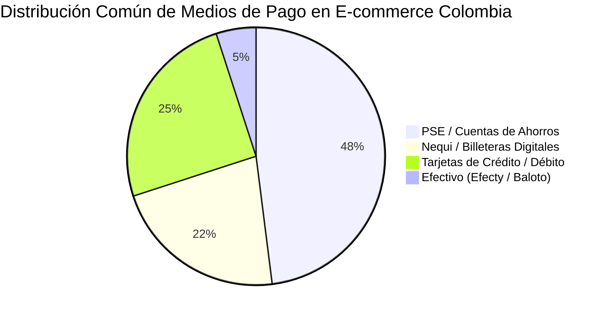
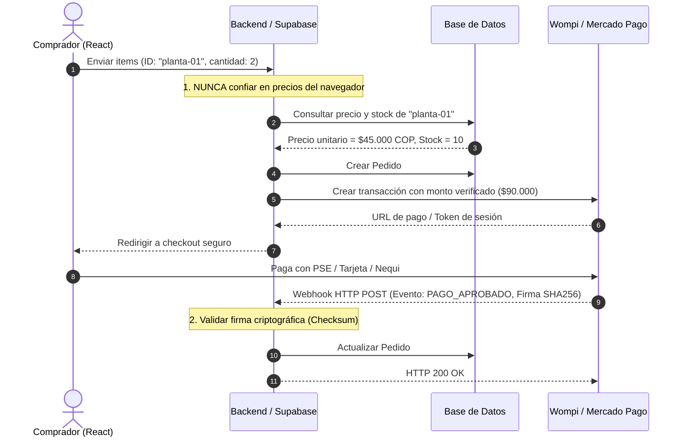

# Estrategia de Infraestructura, Pasarelas de Pago y Costos
## Proyecto: Armony Plantas (E-Commerce Colombia)

> **Documento Estratégico y Técnico**  
> **Versión:** 1.0 (Alpha a Producción)  
> **Target:** Mercado Colombiano (COP, PSE, Nequi, Envíos Departamentales)  
> **Stack Base:** React 19 + Vite + Tailwind CSS + Zustand + Zod

---

## 1. Resumen Ejecutivo y Diagnóstico

El proyecto **Armony Plantas** cuenta con una base sólida de frontend desarrollada en React 19, con un diseño personalizado, catálogo interactivo, cálculo de envíos por departamento/ciudad y un flujo de checkout estructurado con validaciones mediante Zod.

Actualmente, el flujo de compra opera en modo simulado (`localStorage` y `setTimeout`). Para dar el salto de **Alpha a Producción**, el reto principal no es rehacer la interfaz, sino dotarla de:
1. Una infraestructura de backend que valide precios y controle inventarios reales.
2. Una pasarela de pago segura con soporte para los métodos preferidos en Colombia (PSE, Nequi, Tarjetas).
3. Una arquitectura que minimice costos fijos mientras la tienda valida sus primeras ventas.

---

## 2. El Dilema Central: ¿Desarrollo a Medida vs. Plataformas Comerciales?

Uno de los mayores dilemas al tener un frontend avanzado es decidir si conviene seguir programando las capas faltantes o migrar a una plataforma SaaS (como Shopify o Tiendanube).



### Tabla Comparativa Multidimensional

| Criterio | Opción A: Tu React + Supabase (Recomendada) | Opción B: Migrar a Tiendanube | Opción C: Migrar a Shopify | Opción D: Headless Open Source (Medusa.js) |
| :--- | :--- | :--- | :--- | :--- |
| **Costo Fijo Mensual** | **$0 COP** (Capa gratuita) | **$19.900 a $49.900 COP / mes** | **~$25 a $39 USD / mes** (~$100.000 - $160.000 COP) | **$5 a $10 USD / mes** (Hosting VPS) |
| **Aprovechamiento de tu trabajo actual** | **100%**: Conservas todo el diseño, animaciones y componentes creados. | **0%**: Debes rehacer el catálogo y diseño en las plantillas de Tiendanube. | **0% a 10%**: Salvo que uses Shopify Headless (requiere plan costoso). | **80%**: Reutilizas el frontend conectándolo a las APIs de Medusa. |
| **Comisión Extra por Venta** | **0%** (Solo la comisión de la pasarela) | **0%** (en planes estándar) | **2.0% extra** si usas pasarelas externas a Shopify Payments | **0%** (Solo la pasarela) |
| **Tiempo de Salida** | 2 a 3 semanas (conectar backend y pagos) | 1 semana (cargar productos y configurar plantilla) | 1 a 2 semanas | 3 a 5 semanas |
| **Flexibilidad de Diseño** | **Total**: Sin restricciones de CSS, layout o experiencia de usuario. | Limitada a las plantillas y opciones del maquetador. | Buena mediante Liquid, pero atada a la estructura de Shopify. | **Total** |
| **Complejidad de Mantenimiento** | Baja-Media (Supabase gestiona la infraestructura de la base de datos). | Nula (SaaS completamente administrado). | Nula (SaaS completamente administrado). | Media-Alta (debes monitorear servidor Node.js y DB). |

> **Veredicto:** Dado que ya invertiste tiempo y lograste un diseño a medida con Tailwind y React, **la Opción A (Tu React + Supabase) es la más rentable y eficiente**. Te permite operar con costo fijo **cero** durante los primeros meses y conservar intacta la identidad visual de tu marca.

---

## 3. Pasarelas de Pago en Colombia: Comparativa Técnica y Financiera

En el comercio electrónico colombiano, más del 60% de los pagos se realizan mediante transferencias inmediatas (**PSE y Nequi**), seguidas de tarjetas de crédito/débito. Seleccionar una pasarela compatible con estos métodos es vital.



### Tabla Comparativa de Pasarelas

| Pasarela | Comisión Promedio por Transacción | Medios de Pago en Colombia | Integración Técnica | Tiempo de Desembolso |
| :--- | :--- | :--- | :--- | :--- |
| **Wompi** (Grupo Bancolombia) | **2.65% + $700 COP + IVA** *(Tarifa estándar personas/empresas)* | PSE, Botón Bancolombia, Nequi, Tarjetas Visa/Mastercard/Amex/Diners | **Excelente**: Widget web listo, Checkout Redireccionado o API directa con Webhooks | Automático a cuentas Bancolombia en 24h sin cobro por transferencia. |
| **Mercado Pago** | **2.99% a 3.29% + $900 COP + IVA** *(Dependiendo de si retiras el dinero al instante o a los 14 días)* | Tarjetas, PSE, Nequi, Saldo Mercado Pago, Efecty | **Muy Buena**: Checkout Pro (redirección) o Checkout Bricks (componentes incrustados) | Inmediato o programado a cualquier banco (aplica costo de retiro si no es cuenta asociada). |
| **PayU Latam** | **3.49% + $900 COP + IVA** *(Aproximado según volumen)* | Tarjetas, PSE, Efecty, Baloto, Su Red | **Buena**: SDKs y Webhooks, aunque el panel administrativo es más antiguo | Retiros programados a cuenta bancaria (primeros retiros del mes suelen ser gratis). |
| **Stripe** | 2.9% + 30¢ USD | Tarjetas internacionales (No tiene PSE ni Nequi nativo directo a cuentas locales colombianas) | La mejor API del mercado global | **No recomendada** para operar localmente en Colombia sin una sociedad en EE.UU. (Stripe Atlas). |

> **Pasarela Recomendada para Armony Plantas:** **Wompi**.  
> Razones clave:
> 1. Es la solución nativa del banco más grande del país (Bancolombia) y de la billetera más usada (Nequi).
> 2. Las transferencias de fondos hacia cuentas Bancolombia son directas y automáticas.
> 3. Su modelo de **Checkout Redireccionado** o **Widget** te exime de cualquier auditoría compleja de tarjetas.

---

## 4. Arquitectura de Seguridad: ¿Qué Haces Tú y Qué Delega la Pasarela?

La seguridad en pagos en línea no significa programar tu propio procesador de tarjetas. Hacerlo violaría regulaciones internacionales.

### 4.1. Responsabilidades de la Pasarela (Cumplimiento PCI-DSS)
* **Tokenización de Tarjetas:** El cliente ingresa los datos de su tarjeta dentro de un entorno seguro provisto por la pasarela (un iframe protegido o el portal de Wompi/Mercado Pago).
* **Cifrado de Extremo a Extremo:** Los números de tarjeta jamás tocan tu servidor ni tu frontend.
* **Módulos Antifraude:** La pasarela se encarga de analizar scoring de riesgo, validaciones 3D Secure (código SMS del banco) y bloqueos por patrones sospechosos.

### 4.2. Lo que es TU Responsabilidad Estricta (Tu Backend)



#### Reglas de Oro de Seguridad en tu Código:
1. **Validación Server-Side Obligatoria:**  
   Jamás envíes el total a pagar desde el frontend. Si el frontend envía `total: 1000`, un atacante puede interceptar la petición con DevTools y pagar $1.000 COP por una planta de $100.000 COP. El frontend solo envía IDs de productos y cantidades; el backend calcula el total consultando la base de datos.
2. **Validación Criptográfica de Webhooks:**  
   Cuando Wompi o Mercado Pago te notifican que un pago fue aprobado, envían un encabezado con una firma criptográfica (SHA-256 / HMAC). Tu backend debe verificar esa firma con tu clave secreta antes de marcar el pedido como pagado.
3. **Manejo de Secretos:**  
   Variables con prefijo `VITE_` en tu proyecto quedan expuestas en el código bundle de JavaScript público. Las llaves privadas (`WOMPI_PRIVATE_KEY`, `SUPABASE_SERVICE_ROLE_KEY`) deben residir únicamente en el entorno del servidor o de las Edge Functions.

---

## 5. Infraestructura Recomendada y Despliegue ($0 Costo Fijo)

Para maximizar el retorno de inversión y no incurrir en gastos antes de vender, la arquitectura ideal es **Serverless / Jamstack**:

```
[ Frontend: React + Vite + Tailwind ] ──> Vercel / Cloudflare Pages (Free Tier: $0/mes)
               │
               ▼ Consultas y Mutaciones API
[ Backend: Supabase Edge Functions ] ──> Supabase Platform (Free Tier: $0/mes)
               │
               ├─ Base de Datos: PostgreSQL (500 MB incluidos)
               ├─ Autenticación: Supabase Auth (50.000 usuarios activos/mes)
               └─ Almacenamiento: Supabase Storage (1 GB de fotos de plantas)
```

### Opciones de Hosting Frontend

| Proveedor | Plan Gratuito | Ventajas | Desventajas |
| :--- | :--- | :--- | :--- |
| **Vercel** *(Recomendado)* | **$0 / mes** (Uso no comercial o inicial) | Integración con GitHub instantánea, despliegues automáticos por commit, certificado SSL gratis, CDN mundial ultra rápida. | Límites en uso de ancho de banda si superas 100 GB/mes (difícil en fase inicial). |
| **Cloudflare Pages** | **$0 / mes** (Ilimitado) | Ancho de banda ilimitado, CDN más rápida de Latinoamérica, protección contra ataques DDoS de nivel empresarial. | Curva de configuración de redirecciones SPA ligeramente más técnica. |
| **Netlify** | **$0 / mes** | Muy similar a Vercel, excelente para SPAs de React. | Límite de 100 GB de ancho de banda y 300 minutos de build. |

---

## 6. Proyección Real de Costos (Presupuesto Mensual y Anual)

Comparemos los costos reales entre la **Ruta A (Desarrollo Propio Moderno)** y la **Ruta B (Shopify)** en dos fases del negocio.

### Escenario 1: Fase de Lanzamiento (0 a 30 ventas / mes, Ticket promedio $80.000 COP)
*Facturación mensual estimada: $2.400.000 COP*

| Concepto | Ruta A: Tu React + Supabase + Wompi | Ruta B: Shopify + Wompi |
| :--- | :--- | :--- |
| **Hosting Frontend y Backend** | $0 COP | Incluido en la cuota de Shopify |
| **Cuota Fija de Plataforma** | **$0 COP** | **~$140.000 COP** ($35 USD/mes) |
| **Base de Datos y Almacenamiento** | $0 COP (Tier gratuito) | Incluido |
| **Comisión de la Pasarela (Wompi)** | ~$84.500 COP *(2.65% + $700 por cada venta)* | ~$84.500 COP |
| **Cargo Adicional de Plataforma** | **$0 COP** | **~$48.000 COP** *(Shopify cobra 2.0% extra por usar pasarela externa)* |
| **Dominio `.com` o `.co`** | ~$5.000 COP/mes *(~$60.000 COP al año)* | ~$5.000 COP/mes |
| **Gasto Fijo Total Mensual** | **$5.000 COP** | **~$193.000 COP** |
| **Gasto Anual Acumulado** | **~$60.000 COP** | **~$2.316.000 COP** |

> Al mantener tu desarrollo propio, **te ahorras más de $2.200.000 COP en el primer año**, dinero que puedes reinvertir directamente en pauta digital (Instagram/Meta Ads o Google Ads) para atraer clientes a la tienda.

---

## 7. Plan de Acción y Hoja de Ruta (De Alpha a Producción)

Para publicar tu plataforma de forma ordenada y segura, sigue estos 4 hitos:

### Fase 1: Despliegue del Frontend (Semana 1)
- [ ] Subir el repositorio actual a **GitHub** (privado).
- [ ] Conectar el repositorio a **Vercel** o **Cloudflare Pages**.
- [ ] Configurar el archivo de configuración para rutas SPA (`vercel.json` o `_redirects` para que React Router funcione al recargar páginas como `/tienda` o `/checkout`).
- [ ] Comprar el dominio (ej. `armonyplantas.com` o `.co`) y vincularlo en Vercel.

### Fase 2: Configuración de Base de Datos y Backend (Semana 2)
- [ ] Crear un proyecto en **Supabase** (Servidor en región `us-east-1` o la más cercana a Colombia para baja latencia).
- [ ] Crear tablas principales:
  - `products`: ID, nombre, descripción, precio, categoría, stock, imágenes, dificultad de cuidado, luz, riego.
  - `orders`: ID de orden, cliente (nombre, email, teléfono, dirección, ciudad, departamento), items comprados, subtotal, costo_envio, total, estado ('PENDIENTE', 'APROBADO', 'RECHAZADO', 'ENVIADO'), id_transaccion_pasarela.
- [ ] Conectar la lectura del catálogo de React con Supabase en lugar de datos estáticos en memoria.

### Fase 3: Integración de la Pasarela de Pago (Semana 3)
- [ ] Crear cuenta de comercio en **Wompi Sandbox** ([wompi.co](https://wompi.co)).
- [ ] Obtener llaves de prueba: `pub_test_...`, `prv_test_...` e `Integrity Secret`.
- [ ] Crear una **Edge Function** en Supabase:
  - Función `create-payment-transaction`: Recibe los IDs del carrito, consulta precios en la tabla `products`, suma el costo de envío, genera la firma de integridad con el secreto de Wompi y devuelve la referencia al frontend.
  - Función `wompi-webhook`: Recibe el evento de confirmación de Wompi, valida el checksum SHA-256, actualiza el pedido a 'APROBADO' y descuenta las unidades de stock.
- [ ] Conectar el botón "Proceder al Pago" de tu página de Checkout para abrir el Widget de Wompi o redirigir al checkout seguro.

### Fase 4: Pruebas y Salida a Producción (Semana 4)
- [ ] Realizar compras de prueba en Sandbox con tarjetas de test y simulador de PSE/Nequi de Wompi.
- [ ] Verificar que el correo de confirmación y el estado del pedido se actualicen correctamente.
- [ ] Solicitar la activación de la cuenta real de Wompi con los documentos del negocio (RUT / Cédula y certificación bancaria Bancolombia).
- [ ] Cambiar llaves de prueba a llaves de producción en las variables de entorno de Vercel y Supabase.
- [ ] ¡Lanzamiento oficial!
